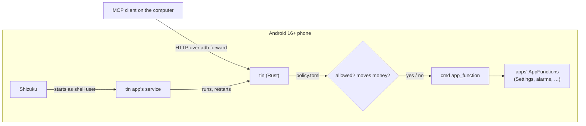

<!-- readme:header:start -->
<p>
  
  
</p>
<!-- readme:header:end -->

# tin

> Lets AI agents use an Android phone's apps through MCP: every app's AppFunctions become typed tools, nothing runs unless you allow it, and payments never do.

<!-- readme:status:start -->
**Active**. I work on it this month.
<!-- readme:status:end -->



## Why

Android 16 added AppFunctions: apps publish typed functions ("create an alarm at 13:37", "read battery state") that
the system can call without touching the screen. Only the system's own assistant gets to call them. Agents that drive
a phone today tap pixels from screenshots, which is slow and breaks on every redesign. I wanted an agent on my
computer to call those same typed functions on my own phone, with a hard rule that nothing touching money ever runs.

## What it does

- Turns every AppFunction on the phone into an MCP (Model Context Protocol, how AI clients call tools) tool with a
  JSON Schema, with no code per app. On my Pixel 8a that is 61 functions in 11 apps.
- Denies everything by default. A policy file on the phone names what is allowed.
- Refuses any function that can move money, whatever the policy says: banking apps (monobank, PrivatBank, Google
  Wallet) and any function id containing `pay`, `transfer`, `topUp`, `purchase` or `buy`.
- Runs as the shell user (uid 2000, the user `adb shell` runs as) under [Shizuku](https://github.com/RikkaApps/Shizuku),
  so it keeps serving after the cable is pulled, and restarts itself if it dies.
- Answers only the shell user and root. Apps on the phone cannot connect, so no app can borrow its access.

Not here: approving money functions from the phone (part 3 of the plan), the phone dialing out to a server, other
users or work profiles, iOS.

## Quick start

You need an Android 16+ phone with USB debugging on, a Mac or Linux machine with `adb`, Rust, the Android NDK and JDK
17+, and [Shizuku](https://github.com/RikkaApps/Shizuku/releases) installed on the phone.

```bash
rustup target add aarch64-linux-android
./scripts/build.sh                                   # Rust core → libtin.so → debug APK
adb install android/app/build/outputs/apk/debug/app-debug.apk
adb shell "$(adb shell pm path moe.shizuku.privileged.api | sed 's/package://; s/base.apk//')lib/arm64/libshizuku.so"
adb shell mkdir -p /data/local/tmp/tin
adb push examples/demo-policy.toml /data/local/tmp/tin/policy.toml
adb shell am start -n io.github.egoushka.tin/.MainActivity   # tap "Allow" in Shizuku's dialog
adb forward tcp:7381 localabstract:tin
```

Then point an MCP client at `http://127.0.0.1:7381/mcp`, or run the acceptance script, which lists the tools and
sets one alarm (keep the phone unlocked; Android refuses device-state functions while locked):

```bash
uv run scripts/accept.py --policy demo --alarm 13:37
```

Without the app, `adb shell /data/local/tmp/tin/bin/tin serve --stdio` speaks MCP over stdin and stdout, and
`tin list --all` shows every function and what the policy decides for it.

## How it works

`tin` is one 570 KB Rust binary. On each `tools/list` it runs `cmd app_function list-app-functions`, parses the
AppSearch documents into tools, and filters them through the policy; `tools/call` runs `cmd app_function
execute-app-function` as a child process with argv, so arguments never pass through a shell. It serves MCP
streamable HTTP on the abstract Unix socket `@tin` and checks each connection's peer uid (`SO_PEERCRED`); adbd runs as
uid 2000, so `adb forward` gets through. On stock Android 17 SELinux already refuses app connections to that socket
before tin sees them.

The Android app does one thing: it asks Shizuku to start a service as the shell user, which copies `tin` out of the
APK to `/data/local/tmp/tin/bin/tin` (mode 700) and keeps `tin serve` running.

The invariant: a money function never reaches `cmd`. The money rule is checked before the allowlist, and a test with
a recording fake backend proves an allow entry for monobank's `topUpPhone` produces zero backend calls.

## Numbers

Pixel 8a, stock Android 17, 2026-11-01, Settings `getBatteryDeviceState` (read-only), 20 calls per path after one
warm-up, nearest-rank percentiles. Source: `scripts/accept.py --bench 20`, two runs; full output in
[docs/results/2026-11-01-pixel-8a.md](docs/results/2026-11-01-pixel-8a.md).

| Path | Run 1 p50 / p95 | Run 2 p50 / p95 |
|---|---|---|
| MCP client → tin over `adb forward` | 1501 / 1642 ms | 1474 / 1538 ms |
| raw `adb shell cmd app_function …` | 1497 / 2055 ms | 1467 / 1670 ms |
| `cmd` alone, timed inside tin | 1432 / 1565 ms | 1398 / 1441 ms |

The bridge is no slower than raw `adb shell` (p95 lower in both runs: one long-lived connection instead of a new
shell per call). What tin plus the USB hop add on top of `cmd` is 69–76 ms at p50 and 77–97 ms at p95. Almost all of
the 1.4 s is the function itself: an unknown function fails in 89–129 ms, so `cmd` and the system service cost about
0.1 s and Settings spends about 1.3 s building its answer.

## Docs

- [docs/specs/2026-11-01-appfunctions-mcp-bridge.md](docs/specs/2026-11-01-appfunctions-mcp-bridge.md): the design,
  acceptance checks A1–A8 and stop conditions.
- [docs/results/2026-11-01-pixel-8a.md](docs/results/2026-11-01-pixel-8a.md): the device run, A4–A8 with evidence.
- [examples/demo-policy.toml](examples/demo-policy.toml): a policy with one allowed alarm, one read-only function and
  one money function that stays refused.
- [AGENTS.md](AGENTS.md): build and test commands, rules for changing the code.

<!-- readme:footer:start -->
---

<sub>Made by [Yehor Hrabovskyi](https://hrabovskyi.online) · [MIT licence](LICENSE).</sub>
<!-- readme:footer:end -->
