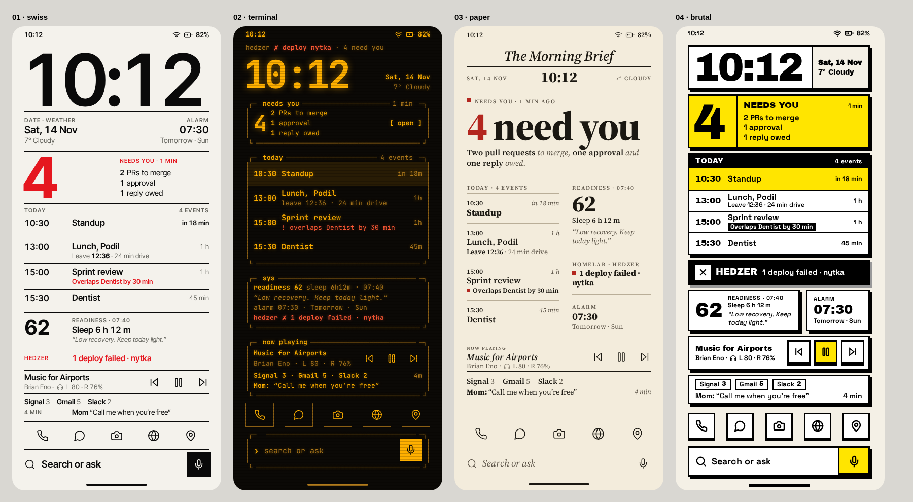
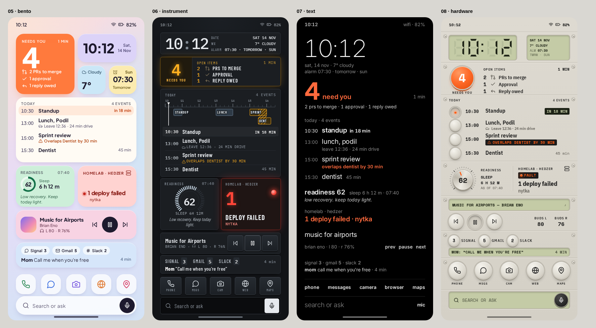
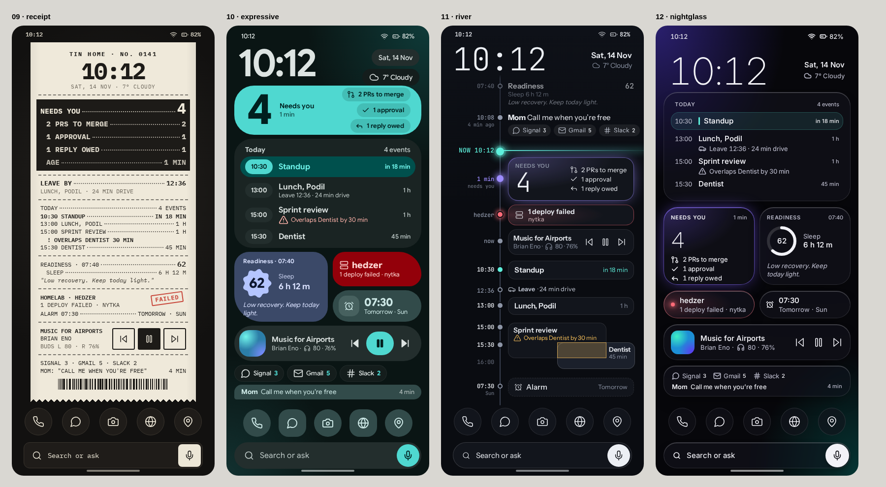
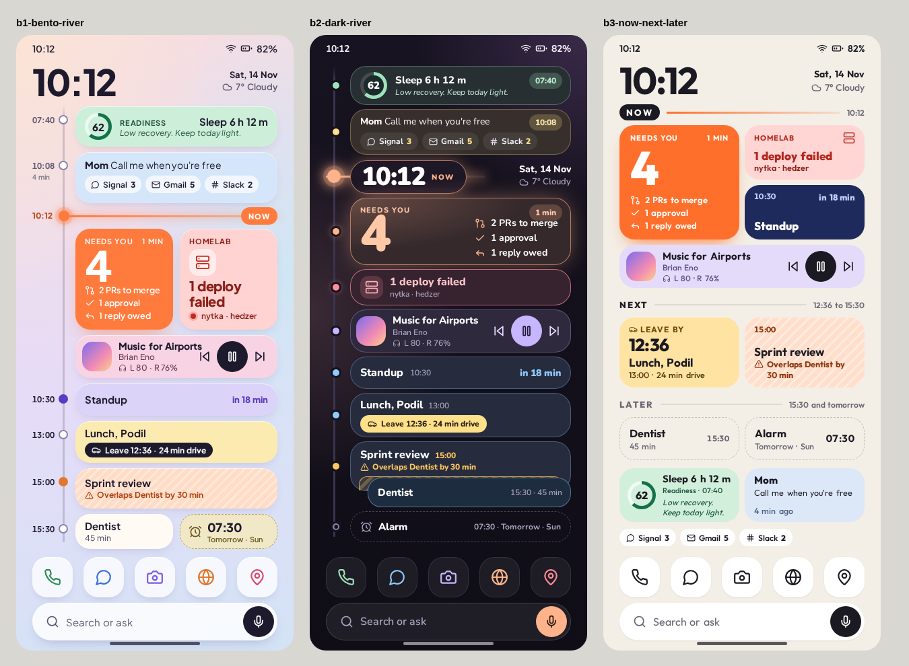
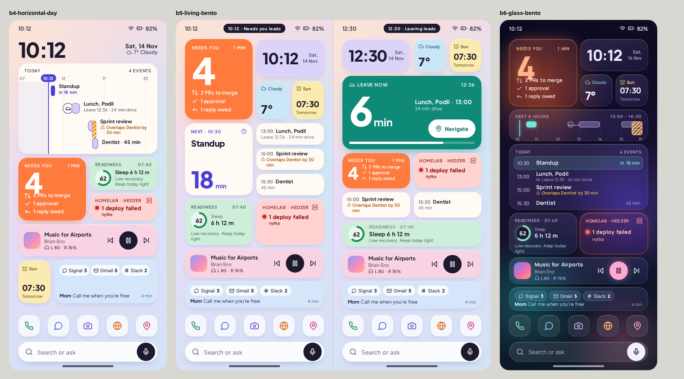

# Home style board, November 2026

Yehor asked for a new direction for Home, so this board comes before any code. It has twelve directions with the same content, and each tile is the full working Home at the Pixel 8a's 412 × 915 dp. Tile 12 is the current design, Night glass, kept for comparison. The brief every tile followed is in [BRIEF.md](BRIEF.md). Open [index.html](index.html) to see the live tiles; each one is a standalone HTML file.

**How to answer:** name one tile, or a mix such as "10's shapes with 6's timeline". "None of these" is also a fine answer. If the board ends there, the next step is your reference screenshots, not another board.

| # | Direction | Idea | Layout concept |
|---|---|---|---|
| 01 | Swiss grid | A timetable poster: off-white, black ink, one signal red | Modular 4-column grid, hairline rules, no boxes |
| 02 | Terminal | A TUI in amber phosphor | Box-drawn panes, prompt-style search |
| 03 | Morning paper | A printed daily brief, serif, e-ink calm | Front page: "4 need you" is the headline, two ruled columns |
| 04 | Brutalist blocks | Loud, square, hard shadows, one yellow | Stacked bordered blocks with pressed edges |
| 05 | Bento widgets | Pastel widget grid on a soft wallpaper | Mixed 1×1, 2×1 and 2×2 tiles; Needs you is the biggest |
| 06 | Instrument panel | Avionics: graphite, gauges, warning lamps | Tick-marked day scale with a now needle; arc gauge; fault lamp |
| 07 | Text only | No icons, no boxes: words at three sizes | A single column of lowercase lines |
| 08 | Hardware panel | Light-grey device with an LCD and round keys | Screwed modules; knob for readiness |
| 09 | Receipt | The day as a thermal-paper receipt | One narrow column with dot leaders and a total |
| 10 | Material expressive | Android 16's tonal shapes in teal | Shape-varied containers: squircle, pills, a cookie for the score |
| 11 | Day river | The day as one vertical time axis | Everything pinned to the axis at its time; now is a bright line |
| 12 | Night glass | The current approved design | Frosted cards in a dark room; light means attention |

The board uses Google Fonts, and the tile builders noted where a face may have fallen back. The phone would bundle whatever the chosen direction needs.

## Round 2: between Bento and Day river

Yehor's verdict on round 1 (2026-11-15): he liked 05 Bento and 11 Day river, "but they still was not quite what i want". Round 2 has six tiles. Each one tests a single idea of what is missing between those two. Its brief is [round-2/BRIEF.md](round-2/BRIEF.md).

| # | Idea it tests |
|---|---|
| b1 | Bento laid out by time: pastel tiles hang off a slim time axis, sized by importance |
| b2 | River, but warmer: a dark axis with soft per-kind pastel tints and big radii |
| b3 | River compressed into Now, Next and Later bands of bento tiles; no literal axis |
| b4 | A horizontal day strip under the clock, with a compact bento below it |
| b5 | Living bento: tile sizes follow the hour, and at 12:30 "Leave now · 6 min" takes over |
| b6 | Bento in a dark room: frosted tiles with pastel accents and a "next 6 hours" ribbon |
